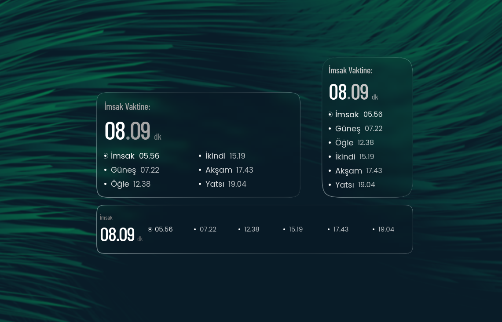

<div align="center">



# Liquid Glass Prayer Times

<i>v1.4</i><br>
Liquid-glass prayer times widget for KDE Plasma 6 — a live countdown to the
next prayer on a macOS-style glass card.<br><br>

<a href="https://github.com/ademsena/liquid-glass-prayer-times/releases/latest">
  
</a>
<a href="https://github.com/ademsena/liquid-glass-prayer-times/blob/master/LICENSE">
  
</a>

</div>

---

A prayer-times widget built on the liquid-glass visual language of
[Liquid Glass — macOS Widgets for KDE](https://github.com/jaxparrow07/liquidglass-kde-widgets)
by Jack Faith. The glass shader, refraction and squircle geometry come from
that project; the content here is prayer times, not one of the stock macOS
widgets.

Everything is sized off the widget's short edge, so the same card scales from
a small desktop tile to a wide panel strip without re-tuning its sizes.

- Worldwide locations: country and city lists plus free-text entry, geocoded
  through Open-Meteo, times from the Aladhan calendar API.
- Three interface languages: English, Türkçe and العربية with a full RTL
  layout and Arabic-Indic digits.
- Idiomatic clock format per language: `05.45` in Turkish, `05:45` otherwise.
- Prayer list in Poppins, countdown in Barlow Condensed, matching the rest of
  the glass widget set.
- One network request per month; the whole month is cached in the plasmoid
  configuration (~2 KB).

## Layout

Font sizes derive from the short edge; the arrangement follows the aspect
ratio, using the same thresholds as the other widgets in the glass set.

| Mode | Trigger | Content |
|---|---|---|
| Portrait | default | countdown on top, six prayers in one column |
| Wide | `w >= 1.55 × h` | countdown on top, prayers 3 left + 3 right |
| Tall portrait | `w <= 0.85 × h` | countdown on top, prayers in one column |
| Bar | `w >= 3 × h` | compact countdown left, dot and time row right |

The corner radius is configured against a 208 px short edge and scaled from
there, so the squircle keeps its proportion in every format instead of looking
over-rounded in the bar or too square when the card grows.

## Settings

| Tab | Content |
|---|---|
| Appearance | glass, corner, chroma and tint options plus style presets; main accent colour and next-prayer colour (picker, palette, hex); warning window in minutes and glow brightness |
| Data | language (English / Türkçe / العربية); country and city; calculation method; 12/24-hour clock; which prayers to show |
| Status | last fetch, days cached, current state, refresh button |

Clicking the widget also refreshes the data.

### Warning glow

When the next prayer is closer than the configured warning window the glass
edge glows in the next-prayer colour. Any colour works — white and red are
both used in practice — and setting the window to `0` disables it entirely.

### Light mode

Glass mode used to hard-wire white content, which made text and accents
invisible on a light card. Content now follows the light/dark polarity, and
the accent and next-prayer colours are darkened automatically on light
backgrounds so a bright mint or white highlight stays readable.

## Data source

```
https://api.aladhan.com/v1/calendar/{year}/{month}?latitude=…&longitude=…&method=13
```

`method=13` matches the calculation parameters used by Turkey's Diyanet
(Fajr 18°, Isha 17°), so Turkish cities agree with the official values to the
minute. Every other city is resolved through Open-Meteo geocoding and the
correct time zone is passed to Aladhan. Diyanet's own service was not usable
from Qt (TLS 1.2 only, login required).

The whole month arrives in one request and is stored in the plasmoid
configuration. Without a connection the widget shows the cached month with a
small notice and refreshes itself when the month turns.

## Installation

### Prerequisites

- KDE Plasma 6.x and Qt 6.x
- `kpackagetool6`, which ships with Plasma

### From a release (recommended)

1. Download the newest `liquid-glass-prayer-times-x.y.plasmoid` from the
   [releases page](https://github.com/ademsena/liquid-glass-prayer-times/releases/latest).
2. In Plasma: **Add Widgets → Get New Widgets… → Install from file**, then
   select the downloaded package.
3. Add **Liquid Glass Prayer Times** to your desktop or panel.

From a terminal, the same step is:

```bash
kpackagetool6 -t Plasma/Applet -i liquid-glass-prayer-times-x.y.plasmoid   # install
kpackagetool6 -t Plasma/Applet -u liquid-glass-prayer-times-x.y.plasmoid   # update
```

### From source

```bash
git clone https://github.com/ademsena/liquid-glass-prayer-times.git
cd liquid-glass-prayer-times

./install.sh    # installs to ~/.local/share/plasma/plasmoids/ (no root needed)
./package.sh    # builds dist/liquid-glass-prayer-times-<version>.plasmoid
```

`install.sh` replaces the installed copy and prints the next step. If the
widget does not appear in the list, restart the shell:

```bash
kquitapp6 plasmashell && kstart6 plasmashell
```

To preview in a single window during development:

```bash
plasmawindowed com.adems.macoswidgets.namaz
```

## License

The source code in this repository is licensed under the
**GNU General Public License v3.0 (GPL-3.0)**. See [`LICENSE`](LICENSE).

You may use, modify and redistribute the code under those terms, keeping the
copyright and attribution notices intact, providing the source, and licensing
derivative work under GPL-3.0.

### Third-party assets

The bundled fonts are **Poppins** and **Barlow**, both licensed under the
SIL Open Font License and included for the typography of the list and the
countdown.

### Attribution

The liquid-glass visual foundation — the backdrop sampling, kawase blur
chain, refraction shader and squircle geometry in
`contents/ui/components/LiquidGlass.qml` and its shaders — is derived from
**[Liquid Glass — macOS Widgets for KDE](https://github.com/jaxparrow07/liquidglass-kde-widgets)**
by **Jack Faith (jaxparrow07)**, used under GPL-3.0. Credit for that work
belongs to its author; this project only adds prayer-times content and its
surrounding logic on top of it.

If you like the visual language, go and star the original project:

- Repository: https://github.com/jaxparrow07/liquidglass-kde-widgets
- Releases: https://github.com/jaxparrow07/liquidglass-kde-widgets/releases/latest

This project is not affiliated with, endorsed by or sponsored by Apple Inc.
All product names and brands are property of their respective owners.

## Official sources

This widget is free. The only official download locations are:

- Source: https://github.com/ademsena/liquid-glass-prayer-times
- Releases: https://github.com/ademsena/liquid-glass-prayer-times/releases/latest

If you find a copy that removes attribution, hides the source or presents
this work as its own, it violates the license.

---

## Türkçe

**KDE Plasma 6** için liquid-glass görünümünde namaz vakti widget'ı: sıradaki
vakte canlı geri sayım, cam kart üzerinde.

Görsel temel,
[Jack Faith (jaxparrow07)](https://github.com/jaxparrow07/liquidglass-kde-widgets)
tarafından geliştirilen **Liquid Glass — macOS Widgets for KDE** projesinden
GPL-3.0 kapsamında uyarlanmıştır; cam shader'ı ve squircle geometrisi ona
aittir, bu proje üzerine namaz vakti içeriğini ekler.

- Dünya çapında konum: ülke/şehir listeleri ve serbest yazım, Open-Meteo
  geocoder, Aladhan takvim API'si.
- Üç arayüz dili: Türkçe, English, العربية (tam RTL ve Arapça rakamlar).
- Türkçe saat biçimi `05.45`, diğer dillerde `05:45`; saniye yok.
- Ayda tek istek, tam ay önbelleği (yaklaşık 2 KB).
- Köşe yarıçapı 208 px kısa kenara göre ölçeklenir; dikey, geniş ve bar
  formatlarında aynı oranı korur.
- Açık (beyaz) modda metin ve vurgu renkleri otomatik koyulaştırılır, böylece
  parlak vurgu rengi beyaz zeminde okunabilir kalır.

Kurulum: **Releases** sayfasından `liquid-glass-prayer-times-x.y.plasmoid` indirin,
sonra **Widget Ekle → Get New Widgets… → Install from file**. Kaynaktan:

```bash
./install.sh     # ~/.local/share/plasma/plasmoids/ altına kurar
./package.sh     # dist/liquid-glass-prayer-times-<sürüm>.plasmoid üretir
```

Görünüm sekmesinde renkler, köşe yarıçapı ve uyarı süresi; Veri sekmesinde
dil, ülke/şehir ve hesaplama yöntemi bulunur. Widget'a tıklamak verileri
tazeler.

---

## العربية

ويدجت مواقيت الصلاة بتصميم الزجاج السائل لـ **KDE Plasma 6**، مع عدّاد تنازلي
حيّ حتى الصلاة القادمة على بطاقة زجاجية.

الأساس البصري مقتبس من مشروع
[Liquid Glass — macOS Widgets for KDE](https://github.com/jaxparrow07/liquidglass-kde-widgets)
للمطوّر Jack Faith (jaxparrow07) بموجب رخصة GPL-3.0؛ التظليل الزجاجي وهندسة
الحواف من عمله، وهذا المشروع يضيف محتوى مواقيت الصلاة.

- مواقع عالمية عبر Open-Meteo وواجهة Aladhan للتقويم.
- ثلاث لغات للواجهة: العربية، English، Türkçe، مع دعم كامل للاتجاه من اليمين
  إلى اليسار والأرقام العربية.
- التثبيت: نزّل ‎`liquid-glass-prayer-times-x.y.plasmoid` من صفحة **Releases**، ثم
  **إضافة ودجات → Get New Widgets… → Install from file**.
